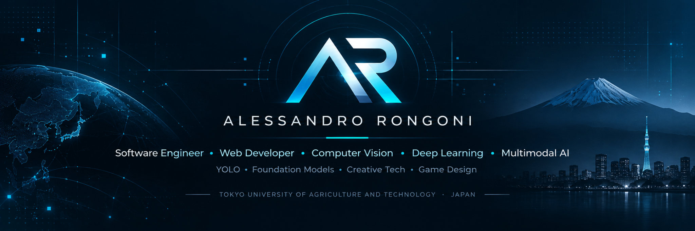

  

   

  
  
  
  

  
<b>💻 Software Engineer &amp; Web Developer &nbsp;·&nbsp; 🧠 AI &amp; Computer Vision Engineer &nbsp;·&nbsp; 🎓 PhD Student</b>

  
Building software, intelligent systems and things that are fun to explore.

---

## 👋 About Me

I'm **Alessandro Rongoni**, an Italian **Software Engineer, Web Developer and AI / Computer Vision Engineer**, currently based in **Tokyo, Japan** 🇯🇵.

I enjoy building complete solutions: **web and mobile applications**, **machine learning / deep learning pipelines**, **computer vision systems** and **IoT / embedded prototypes**. I'm particularly interested in **YOLO and object detection**, **pose estimation**, **domain adaptation**, **multimodal learning**, **foundation models** and **Edge AI**.

🎓 I'm pursuing a **PhD at Tokyo University of Agriculture and Technology (TUAT)**, applying AI to real-world problems, including **smart agriculture**, plant health and predictive systems. I hold an **MSc in Computer and Automation Engineering** from **Università Politecnica delle Marche**.

I like turning ideas into working software — from intelligent greenhouses and lightweight inference on Raspberry Pi to full-stack applications and interactive experiences.

### 🎨 Beyond Code

- 🎮 **Indie games, game design, pixel art & creative coding**
- ⚽ Playing soccer
- 🎣 Fishing and spending time in nature
- ✈️ Travelling and discovering new cultures
- 💃 Dancing and enjoying music
- 🌍 Meeting people and exchanging ideas

---

## 🛠️ Skills & Tech Stack

### 💻 Programming & Web Development

### 🧠 AI, Deep Learning & Computer Vision

### 🌐 Frameworks, Apps & Cloud

### 🔌 Embedded Systems & IoT

---

## 🚀 Featured Projects

### 🌾 Smart Greenhouse System · TUAT, Tokyo

Developed a **cloud-based IoT system** for greenhouse monitoring and control, integrating **computer vision** and **neural networks** for plant disease detection and watering prediction. Combining AI, sensors, connected hardware and cloud services for **precision agriculture**.

### 🐬 DELFI · Real-Time Dolphin Whistle Detection

Built a **real-time acoustic detection system** on **Raspberry Pi Zero 2 W**, using a **TensorFlow Lite CNN** for on-device inference. Published in *MDPI Robotics* (2025).

📄 [Read the paper](https://doi.org/10.3390/robotics14050067) · 🔒 Project repository is private

### 🔋 Lithium-Ion Battery Remaining Useful Life (RUL)

Worked on **battery lifetime estimation** using deep learning and lightweight forecasting methods, including **LSTM / Echo State Network approaches**.

🔗 [GitHub repository](https://github.com/LorenzoLongarini/RUL-estimation-of-lithium-batteries) · 📄 [IEEE CoDIT paper](https://doi.org/10.1109/CoDIT66093.2025.11321479)

### 🧠 Next Activity Prediction with Graph Neural Networks

Explored **graph-based business process prediction** with **GATv2Conv** and **message-passing GNNs (MPGNN)**.

### 🔍 Violence & Fall Detection with Deep Learning

Developed **pose-based spatio-temporal models** for recognizing violence and detecting falls, presented at **IEEE MetroXRAINE 2025**.

📄 [Violence detection](https://doi.org/10.1109/MetroXRAINE66377.2025.11340312) · 📄 [Fall detection](https://doi.org/10.1109/MetroXRAINE66377.2025.11340043)

### 📱 FitTracker · Android & On-Device AI

Developed features for a **fitness and calorie-tracking Android application** using **TensorFlow Lite**, **Firebase ML Kit** and computer vision.

🔗 [GitHub repository](https://github.com/FedePreto/Progetto_Programmazione_Mobile)

### 🌐 Software, Web & Creative Projects

Beyond AI research, I enjoy **web development, app engineering, software tooling**, and experimenting with **game mechanics, interactive prototypes and pixel-art assets**.

🔗 [Explore my repositories](https://github.com/AlessandroRongoni?tab=repositories)

---

## 📚 Publications

Research in **computer vision, deep learning, Edge AI, predictive modelling and intelligent systems**.

<!-- AUTO-PUBLICATIONS:START -->
### 📰 Journal Articles

#### 2025

- **[Real-Time Dolphin Whistle Detection on Raspberry Pi Zero 2 W with a TFLite Convolutional Neural Network](https://doi.org/10.3390/robotics14050067)**  
  R. De Marco, F. Di Nardo, **A. Rongoni**, et al.  
  *Robotics, 14(5), 67*, 2025. · [DOI](https://doi.org/10.3390/robotics14050067)

### 🎤 Conference & Workshop Papers

#### 2026

- **[Time series Foundation Models based on Physics-Informed Synthetic Histories for Cold-Start Photovoltaic Forecasting](https://arxiv.org/abs/2606.07457)**  
  L. Longarini, **A. Rongoni**, S. Silenzi, E. Frontoni, R. Rosati  
  *ICML Workshop on Foundation Models for Structured Data*, 2026. · [arXiv](https://arxiv.org/abs/2606.07457)

#### 2025

- **[Spotting the Aggressor: Pose-Based Violence Detection Through Spatial-Temporal Deep Learning Techniques](https://doi.org/10.1109/metroxraine66377.2025.11340312)** ⭐ *First author*  
  **A. Rongoni**, L. Longarini, M. R. Prist, G. Pompei, A. F. Dragoni  
  *IEEE MetroXRAINE*, 2025. · [DOI](https://doi.org/10.1109/metroxraine66377.2025.11340312)

- **[Preventing Elderly Injuries: A Pose-Based Framework for Fall Detection](https://doi.org/10.1109/metroxraine66377.2025.11340043)**  
  L. Longarini, **A. Rongoni**, M. R. Prist, G. Pompei, A. F. Dragoni  
  *IEEE MetroXRAINE*, 2025. · [DOI](https://doi.org/10.1109/metroxraine66377.2025.11340043)

- **[A Lightweight Deep Learning Approach for Lithium-ion Battery RUL Estimation](https://doi.org/10.1109/codit66093.2025.11321479)**  
  L. Longarini, **A. Rongoni**, M. R. Prist, et al.  
  *IEEE CoDIT*, 2025. · [DOI](https://doi.org/10.1109/codit66093.2025.11321479)

- **[ESN-based Distributed Inference Methods for Production Line Energy Forecasting](https://doi.org/10.1016/j.ifacol.2025.09.375)**  
  A. Bonci, L. Longarini, **A. Rongoni**, et al.  
  *IFAC MIM / IFAC-PapersOnLine*, 2025. · [DOI](https://doi.org/10.1016/j.ifacol.2025.09.375)

#### 2024

- **[Benchmark Analysis of YOLOv8 for Edge AI Video-Surveillance Applications](https://doi.org/10.1109/mesa61532.2024.10704889)**  
  D. Berardini, L. Migliorelli, **A. Rongoni**, et al.  
  *IEEE/ASME MESA*, 2024. · [DOI](https://doi.org/10.1109/mesa61532.2024.10704889)

#### 2018

- **[A Low-Cost Cherenkov Detector to Be Tested in CERN&#x27;s T9 Beam Line](https://cds.cern.ch/record/2669840)**  
  M. R. Felici, G. V. Pastanella, **A. Rongoni**, et al.  
  *Proceedings of Science*, 2018.
<!-- AUTO-PUBLICATIONS:END -->

📖 [**All publications on ORCID**](https://orcid.org/0009-0002-2907-8998)

---

## 🎓 Education

🎓 **PhD Student · Tokyo University of Agriculture and Technology (TUAT)**  
*Tokyo, Japan · 2026–present*

🎓 **Master's Degree in Computer and Automation Engineering**  
*Università Politecnica delle Marche · Sep 2022 – Jul 2025*  
**Thesis:** *Domain Adaptation Techniques for Automatic Plant Disease Recognition*  
**Grade:** **107/110**

🎓 **Bachelor's Degree in Computer and Automation Engineering**  
*Università Politecnica delle Marche · Sep 2019 – May 2023*

---

## 💼 Experience

- 🔬 **Research Intern · Tokyo University of Agriculture and Technology (2024)**  
  Developed a low-cost **smart greenhouse** with cloud infrastructure and AI-driven plant monitoring.
- 📱 **Software / Computer Vision Intern · Università Politecnica delle Marche (2022)**  
  Implemented computer vision and pose-estimation features for **FitTracker**.

---

## 🏆 Achievements

- 🧪 **Winner — CERN Beamline for Schools (2017)**
- 📄 **Co-author of IEEE / IFAC research publications** — MESA 2024, CoDIT 2025, MIM 2025, MetroXRAINE 2025
- 🌐 **First-author research paper — IEEE MetroXRAINE (2025)**
- 🌏 **International academic experience** — Italy and Japan

---

## 📈 GitHub Stats

  
  

  
📊 More GitHub activity

   
  

    
    
  

---

  <b>✨ Thanks for stopping by!</b> 
  Explore my projects, papers and experiments — or get in touch.  
  <a href="https://github.com/AlessandroRongoni">GitHub</a> ·
  <a href="https://www.linkedin.com/in/alessandro-rongoni/">LinkedIn</a> ·
  <a href="https://orcid.org/0009-0002-2907-8998">ORCID</a> ·
  <a href="mailto:alessandro.rongoni2000@gmail.com">Email</a>

