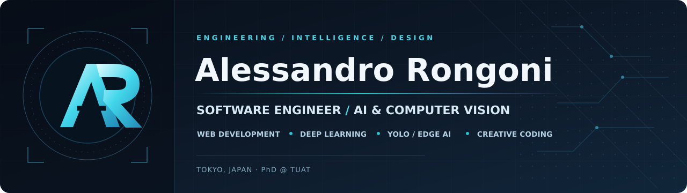

<!-- GitHub Profile README · Alessandro Rongoni · Updated October 2026 -->

  

  
  
  
  
  

  
<strong>Computer Vision · Multimodal AI · Foundation Models · Precision Agriculture</strong>

## 👨‍🔬 About me

I'm a **PhD student at Tokyo University of Agriculture and Technology (TUAT), Japan**, working in the **Ikuko Shimizu Laboratory**, and a Computer & Automation Engineer with a background in **computer vision, deep learning, and embedded intelligent systems**.

My research interests include **multimodal and spatio-temporal learning**, **foundation models**, **time-series forecasting**, and **AI for precision agriculture**. I work at the intersection of research and engineering, turning models into systems that can operate in real-world environments.

- 📍 **Tokyo, Japan** · originally from Italy
- 🎓 **PhD in Electrical Engineering and Computer Science** · TUAT (2026–present)
- 🌱 **Research focus:** crop monitoring and forecasting using visual, sensor, weather, and remote-sensing data
- 🤝 Open to research collaboration in **Computer Vision, Multimodal AI, Time Series, and Edge AI**

## 🔬 Research directions

| | Area | What I'm exploring |
|:--:|---|---|
| 🌾 | **AI for Smart Agriculture** | Crop health, disease recognition, and predictive decision support |
| 🧩 | **Multimodal Learning** | Combining visual, environmental, sensor, and temporal signals |
| 🧠 | **Foundation Models** | Transfer and adaptation in data-constrained settings |
| ⏳ | **Time-Series Forecasting** | Spatio-temporal prediction and zero-shot / cold-start modelling |
| ⚡ | **Edge AI & IoT** | Efficient perception and intelligent systems on resource-limited hardware |

## ✨ Latest research · automatic updates

The publications below are refreshed from [ORCID](https://orcid.org/0009-0002-2907-8998)-linked scholarly metadata through OpenAlex, with optional direct ORCID API synchronization. Updates run daily via GitHub Actions; only indexed public metadata is shown.

<!-- AUTO-PUBLICATIONS:START -->
_The first automated publication sync runs after the workflow is enabled._
<!-- AUTO-PUBLICATIONS:END -->

## 📚 Selected publications

### 2026

**Time series Foundation Models based on Physics-Informed Synthetic Histories for Cold-Start Photovoltaic Forecasting**  
L. Longarini, **A. Rongoni**, S. Silenzi, E. Frontoni, R. Rosati.  
*2nd ICML Workshop on Foundation Models for Structured Data (FMSD 2026), poster.*  
[**arXiv:2606.07457**](https://arxiv.org/abs/2606.07457) · [Workshop](https://icml-structured-fm-workshop.github.io/accepted-papers/)

### 2025

**Real-Time Dolphin Whistle Detection on Raspberry Pi Zero 2 W with a TFLite Convolutional Neural Network**  
R. De Marco, F. Di Nardo, **A. Rongoni**, L. Screpanti, D. Scaradozzi.  
*Robotics*, 14(5), 67.  
[**DOI: 10.3390/robotics14050067**](https://doi.org/10.3390/robotics14050067)

**Spotting the Aggressor: Pose-Based Violence Detection Through Spatial-Temporal Deep Learning Techniques** ⭐ *First author*  
**A. Rongoni**, L. Longarini, M. Prist, G. Pompei, A. F. Dragoni.  
*IEEE MetroXRAINE 2025.*  
[**DOI: 10.1109/MetroXRAINE66377.2025.11340312**](https://doi.org/10.1109/MetroXRAINE66377.2025.11340312)

**Preventing Elderly Injuries: A Pose-Based Framework for Fall Detection**  
L. Longarini, **A. Rongoni**, A. F. Dragoni, G. Pompei, M. Prist.  
*IEEE MetroXRAINE 2025.*  
[**DOI: 10.1109/MetroXRAINE66377.2025.11340043**](https://doi.org/10.1109/MetroXRAINE66377.2025.11340043)

**A Lightweight Deep Learning Approach for Lithium-ion Battery RUL Estimation**  
L. Longarini, M. Prist, A. Freddi, A. Monteriù, **A. Rongoni**, et al.  
*IEEE CoDIT 2025.*  
[**DOI: 10.1109/CoDIT66093.2025.11321479**](https://doi.org/10.1109/CoDIT66093.2025.11321479)

**ESN-based Distributed Inference Methods for Production Line Energy Forecasting**  
A. Bonci, M. Prist, E. Caizer, F. Giuggioloni, L. Longarini, G. Pompei, **A. Rongoni**.  
*IFAC-PapersOnLine*, 59(10), 2230–2237; MIM 2025.  
[**DOI: 10.1016/j.ifacol.2025.09.375**](https://doi.org/10.1016/j.ifacol.2025.09.375)

### Earlier work

**Benchmark Analysis of YOLOv8 for Edge AI Video-Surveillance Applications**  
D. Berardini, L. Migliorelli, L. Cardoni, C. Parente, **A. Rongoni**, et al.  
*IEEE/ASME MESA 2024.* [**DOI**](https://doi.org/10.1109/MESA61532.2024.10704889)

**A Low-Cost Cherenkov Detector to Be Tested in CERN's T9 Beam Line**  
M. R. Felici et al. (including **A. Rongoni**).  
*Proceedings of Science (EPS-HEP2017), published 2018.* [**CERN record**](https://cds.cern.ch/record/2669840)

<a href="https://orcid.org/0009-0002-2907-8998">See research identity on ORCID ↗</a>

## 🚀 Featured research & engineering

| Project | Highlights | Links |
|---|---|---|
| 🌾 **Smart Greenhouse @ TUAT** | IoT/cloud-based plant monitoring, computer vision, and intelligent control | Research prototype |
| ☀️ **Cold-start PV Forecasting** | Physics-informed synthetic histories and zero-shot time-series foundation models | [Paper](https://arxiv.org/abs/2606.07457) |
| 🐬 **DELFI · Dolphin Whistle Detection** | Raspberry Pi Zero 2 W and TFLite CNN for real-time bioacoustics | [Paper](https://doi.org/10.3390/robotics14050067) |
| 🔋 **Battery Remaining Useful Life** | Battery health forecasting; lightweight Echo State Networks benchmarked against LSTM | [Code](https://github.com/LorenzoLongarini/RUL-estimation-of-lithium-batteries) · [Paper](https://doi.org/10.1109/CoDIT66093.2025.11321479) |
| 👁️ **Pose-based Event Recognition** | Spatio-temporal modelling for violence and fall detection | [Violence detection](https://doi.org/10.1109/MetroXRAINE66377.2025.11340312) · [Fall detection](https://doi.org/10.1109/MetroXRAINE66377.2025.11340043) |
| 📱 **FitTracker** | Mobile fitness application with on-device ML integrations | [Code](https://github.com/FedePreto/Progetto_Programmazione_Mobile) |

Other experience includes **Graph Neural Networks for business-process activity prediction**, domain adaptation for plant disease recognition, and embedded AI prototypes.

## 🛠️ Technical stack

**AI & data**  
     

**Engineering & software**  
    

**IoT & embedded**  
   

## 📊 Contribution snapshot · automatically refreshed

  

This card is regenerated daily using GitHub's GraphQL API. Private contributions may be counted **only if** GitHub's private-contribution visibility setting and the token's permissions allow it. No repository identities or code are included.

## 📈 Public GitHub statistics & languages

  
  

Stats are generated by third-party services from available GitHub activity. Language percentages reflect repository composition, not proficiency; private or organization contributions may not be fully represented.

## 🎓 Education & milestones

- **2026–present** · PhD Student, **Tokyo University of Agriculture and Technology (TUAT)**, Japan
- **2022–2025** · MSc, Computer and Automation Engineering, **Università Politecnica delle Marche**, Italy  
  Thesis: *Domain Adaptation Techniques for Automatic Plant Disease Recognition* · **107/110**
- **2019–2023** · BSc, Computer and Automation Engineering, **Università Politecnica delle Marche**
- **2017** · Winner, **CERN Beamline for Schools**

---

  <strong>Interested in research, engineering, or international collaborations?</strong> 
  <a href="mailto:alessandro.rongoni2000@gmail.com">Email me</a> ·
  <a href="https://www.linkedin.com/in/alessandro-rongoni/">LinkedIn</a> ·
  <a href="https://orcid.org/0009-0002-2907-8998">ORCID</a>

